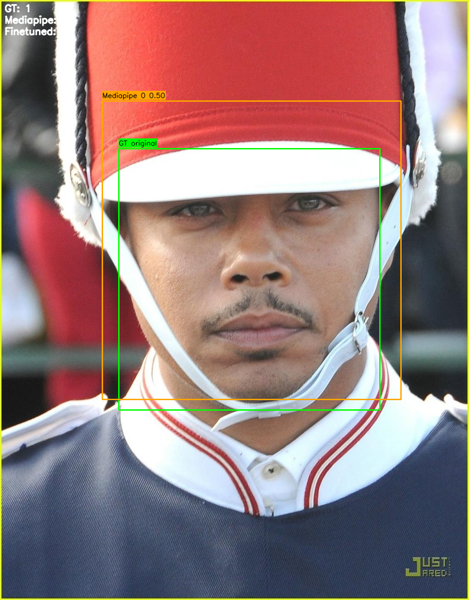
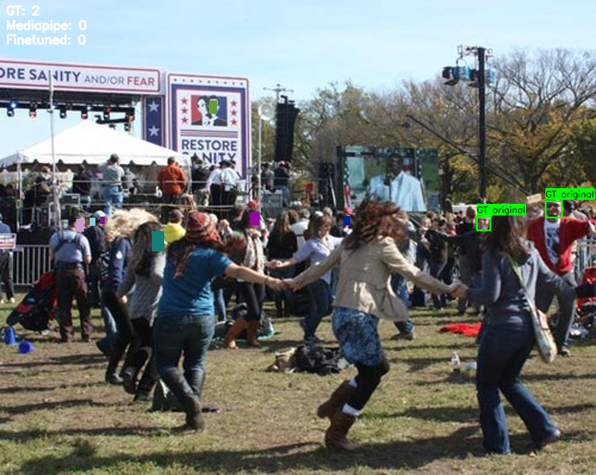
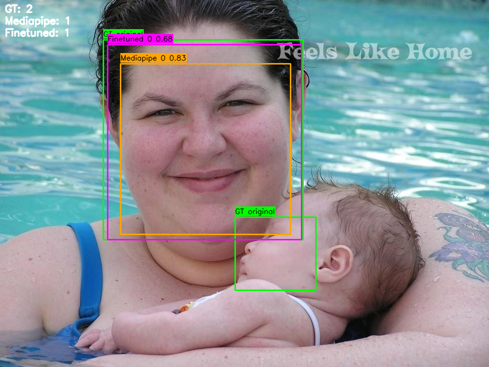

# Trainable BlazeFace

A PyTorch implementation of BlazeFace that supports fine-tuning from MediaPipe's pretrained weights.

**[Live demo](https://shameem4.github.io/trainable_blazeface/)** &mdash; the stock MediaPipe
detector and this repo's retrained weights side by side, running entirely in your browser.
No image leaves the page.

---

## Motivation

BlazeFace is a lightweight face detection model developed by Google for mobile applications. It achieves real-time performance (200+ FPS on mobile GPUs) while maintaining reasonable accuracy for its intended use case: detecting a single frontal face in selfie-style images.

However, the pretrained weights distributed through MediaPipe come as a TensorFlow Lite graph, which cannot be trained, and existing PyTorch ports such as [hollance/BlazeFace-PyTorch](https://github.com/hollance/BlazeFace-PyTorch) are inference-only.

This repository adds, on top of those ports:

1. Loading of the MediaPipe weights into a plain PyTorch model whose parameters can be fine-tuned
2. A CSV-based dataset with augmentation and MediaPipe-style anchor target encoding
3. A hard-negative-mining detection loss (focal or BCE on logits, Huber on boxes) and a trainer
4. Evaluation and debugging tools

**Important:** MediaPipe's batch normalization is *folded* into the convolution weights and biases, and this repository keeps it that way. The model has **no BatchNorm layers**; the folded conv weights/biases are fine-tuned directly. (Earlier revisions of this README described an "unfolded BatchNorm" architecture; that code was never used by the model and has been removed in v2.)

---

## Overview

```text
MediaPipe weights (.pth, BN folded into convs)
        │  loaded as-is (regressor heads split into box / keypoint parts)
        ▼
BlazeFace (PyTorch, BlazeBlock_WT, no BN)  ◀── CSV images + boxes ──▶ anchor encoding (896 targets)
        │                                                                   │
        └──────────────────────── detection loss ◀─────────────────────────┘
                                         │
                                  AdamW fine-tuning
```

Because the weights are loaded unchanged, the model reproduces MediaPipe's outputs at initialization.

---

## Architecture

### BlazeFace Detector

BlazeFace is an anchor-based single-shot detector (SSD) designed for mobile inference. The architecture uses depthwise separable convolutions throughout, similar to MobileNet.

```text
                           INPUT IMAGE
                           128 × 128 × 3
                                │
                                ▼
                    ┌───────────────────────┐
                    │    Initial Conv       │
                    │    5×5, stride 2      │
                    │    → 24 channels      │
                    └───────────┬───────────┘
                                │
                    ╔═══════════╧═══════════╗
                    ║    BACKBONE 1         ║
                    ║    11 BlazeBlocks     ║
                    ║    24→28→32→...→88    ║
                    ╚═══════════╤═══════════╝
                                │
                    Feature Map: 16 × 16 × 88
                    ┌───────────┴───────────┐
                    │                       │
                    ▼                       ▼
          ┌─────────────────┐    ╔═══════════════════════╗
          │  Classifier 8   │    ║    BACKBONE 2         ║
          │  (2 anchors)    │    ║    5 BlazeBlocks      ║
          └────────┬────────┘    ║    88→96→96→96→96→96  ║
                   │             ╚═══════════╤═══════════╝
                   │                         │
                   │             Feature Map: 8 × 8 × 96
                   │             ┌───────────┴───────────┐
                   │             ▼                       ▼
                   │   ┌─────────────────┐    ┌─────────────────┐
                   │   │  Classifier 16  │    │  Regressor 16   │
                   │   │  (6 anchors)    │    │  (box + kpts)   │
                   │   └────────┬────────┘    └────────┬────────┘
                   │            │                      │
                   │            ▼                      ▼
          ┌────────┴────────────┴──────────────────────┴────────┐
          │                                                     │
          │              896 ANCHOR PREDICTIONS                 │
          │                                                     │
          │   ┌─────────────────────────────────────────────┐   │
          │   │  512 small anchors (16×16 grid × 2/cell)    │   │
          │   │  384 large anchors (8×8 grid × 6/cell)      │   │
          │   └─────────────────────────────────────────────┘   │
          │                                                     │
          └─────────────────────────────────────────────────────┘
```

### The BlazeBlock

Each block is a depthwise-separable convolution with a skip connection (the conv biases carry the folded BatchNorm):

```text
         Input
           │
     ┌─────┴─────┐
     ▼           │
┌──────────┐     │  skip: max-pool when stride 2, channel zero-pad
│Depthwise │     │  (or 1×1 projection) when channels grow
│ Conv 3×3 │     │
├──────────┤     │
│Pointwise │     │
│ Conv 1×1 │     │
└────┬─────┘     │
     └─────┬─────┘
         (+) Add
           │
         ReLU (PReLU in some blocks)
           │
        Output
```

Depthwise-separable convs cut parameters roughly 9× versus a dense 3×3 conv (`C·9 + C²` vs `9·C²`). The whole model has 101,390 parameters.

---

## Anchor System

BlazeFace predicts face locations relative to a grid of **anchor boxes**. This is the heart of how single-shot detectors work.

### Anchor Grid Visualization

```text
                    16×16 Grid (512 anchors)                    8×8 Grid (384 anchors)
              ┌───────────────────────────────┐           ┌───────────────────────┐
              │ · · · · · · · · · · · · · · · │           │ · · · · · · · · · · ·│
              │ · · · · · · · · · · · · · · · │           │ · · · · · · · · · · ·│
              │ · · ┌─┐ · · · · · · · · · · · │           │ · · ┌───┐ · · · · · ·│
              │ · · │•│ · · · · · · · · · · · │           │ · · │ • │ · · · · · ·│
              │ · · └─┘ · · · · · · · · · · · │           │ · · └───┘ · · · · · ·│
              │ · · · · · · · · · · · · · · · │           │ · · · · · · · · · · ·│
              │ · · · · · · · · · · · · · · · │           │ · · · · · · · · · · ·│
              │ · · · · · · · · · · · · · · · │           │ · · · · · · · · · · ·│
              │ · · · · · · · · · · · · · · · │           └───────────────────────┘
              │ · · · · · · · · · · · · · · · │
              │ · · · · · · · · · · · · · · · │           Each cell: 6 anchors
              │ · · · · · · · · · · · · · · · │           (for larger faces)
              │ · · · · · · · · · · · · · · · │
              │ · · · · · · · · · · · · · · · │
              │ · · · · · · · · · · · · · · · │
              │ · · · · · · · · · · · · · · · │
              └───────────────────────────────┘

              Each cell: 2 anchors
              (for smaller faces)

                        TOTAL: 512 + 384 = 896 anchors
```

### How Anchors Work

For each anchor, the model predicts:

- **Classification score**: "Is there a face here?" (0 to 1)
- **Box regression**: Offset from anchor center to actual face location (Δy, Δx, Δh, Δw)
- **Keypoints**: 6 facial landmarks (eyes, nose, mouth, ears)

```text
Ground Truth Face              Anchor Grid                 Prediction
┌─────────────────┐    ┌─────────────────────────┐    ┌─────────────────┐
│   ┌─────────┐   │    │   ·   ·   ·   ·   ·     │    │  score = 0.95   │
│   │  😊     │   │    │   ·   ·   ·   ·   ·     │    │  Δy = +0.12     │
│   │         │   │    │   ·   ·   •───┐  ·     │    │  Δx = -0.08     │
│   └─────────┘   │────▶│   ·   ·   ·   │   ·     │────▶│  Δh = +0.31     │
│                 │    │   ·   ·   ·   │   ·     │    │  Δw = +0.25     │
│                 │    │   ·   ·   ·   ·   ·     │    │                 │
└─────────────────┘    └─────────────────────────┘    └─────────────────┘
                              ▲
                              │
                        Best matching
                        anchor (highest IoU)
```

---

## Training Pipeline

### Data Flow

```text
┌─────────────────────────────────────────────────────────────────────────────┐
│                              TRAINING LOOP                                   │
├─────────────────────────────────────────────────────────────────────────────┤
│                                                                             │
│   CSV Data                     Image Loading                                │
│   ┌─────────┐                 ┌─────────────┐                               │
│   │image,   │                 │ Load image  │                               │
│   │x1,y1,   │───────────────▶│ Resize/pad  │                               │
│   │w,h      │                 │ to 128×128  │                               │
│   └─────────┘                 └──────┬──────┘                               │
│                                      │                                      │
│                                      ▼                                      │
│                           ┌──────────────────┐                              │
│                           │   Augmentation   │                              │
│                           │ • Flip           │                              │
│                           │ • Brightness     │                              │
│                           │ • Saturation     │                              │
│                           │ • Color jitter   │                              │
│                           │ • Scale          │                              │
│                           │ • Rotation       │                              │
│                           │ • Occlusion      │                              │
│                           │ • Cutout         │                              │
│                           └────────┬─────────┘                              │
│                                    │                                        │
│         ┌──────────────────────────┼──────────────────────────┐             │
│         ▼                          ▼                          ▼             │
│   ┌───────────┐            ┌───────────────┐          ┌────────────┐        │
│   │  Anchor   │            │    Model      │          │   Ground   │        │
│   │  Encoding │            │   Forward     │          │   Truth    │        │
│   │           │            │   Pass        │          │   Targets  │        │
│   │ Box→896   │            │               │          │            │        │
│   │ targets   │            │  BlazeFace()  │          │  cls: 0/1  │        │
│   └─────┬─────┘            └───────┬───────┘          │  box: YXYX │        │
│         │                          │                  └──────┬─────┘        │
│         │                          │                         │              │
│         ▼                          ▼                         ▼              │
│   ┌─────────────────────────────────────────────────────────────────┐       │
│   │                           LOSS FUNCTION                         │       │
│   │                                                                 │       │
│   │   L = w_box × L_box + w_bg × L_bg + w_pos × L_pos               │       │
│   │                                                                 │       │
│   │   L_box: Huber loss on positive anchor box predictions          │       │
│   │   L_bg:  Focal loss on hard negative backgrounds                │       │
│   │   L_pos: Focal loss on positive anchors (faces)                 │       │
│   │                                                                 │       │
│   │   Hard Negative Mining: select ratio × positives negatives      │       │
│   │   (highest scoring false positives are most informative)        │       │
│   │                                                                 │       │
│   └───────────────────────────────────┬─────────────────────────────┘       │
│                                       │                                     │
│                                       ▼                                     │
│                              ┌─────────────────┐                            │
│                              │   Backprop +    │                            │
│                              │   AdamW Update  │                            │
│                              └─────────────────┘                            │
│                                                                             │
└─────────────────────────────────────────────────────────────────────────────┘
```

### Loss Functions

`train_blazeface.py` defaults: `w_box=200`, `w_bg=60`, `w_pos=80`, hard-negative ratio 2, focal loss (α=0.25, γ=2). The `BlazeFaceDetectionLoss` class itself defaults to 150/35/35, ratio 1, BCE. Classification losses are computed from **raw logits** (`binary_cross_entropy_with_logits`); the earlier probability-space version clamped at 1e-7 and silently dropped the gradient of confidently-wrong anchors.

Object detection training faces significant class imbalance: for every anchor matching a face, there are typically dozens matching background. The loss function addresses this through several mechanisms.

#### Focal Loss (Classification)

Standard cross-entropy treats all examples equally. Focal loss applies a modulating factor that down-weights easy examples (obvious backgrounds) and increases the relative importance of hard cases:

```text
                Standard BCE                    Focal Loss (γ=2)
        │                                │
   Loss │\                               │\
        │ \                              │ \
        │  \                             │  \__________
        │   \                            │
        │    \_____                      │
        │                                │
        └────────────▶                   └────────────▶
           Confidence                       Confidence

"Easy examples dominate             "Hard examples dominate
 gradient updates"                   gradient updates"
```

#### Hard Negative Mining

Rather than using all 800+ background anchors, only the most confident false positives are selected for training. These hard negatives—backgrounds the model incorrectly classifies with high confidence—provide the most informative gradient signal.

#### Huber Loss (Box Regression)

Huber loss combines properties of L1 and L2 losses: quadratic for small errors (smooth gradients near the optimum) and linear for large errors (robustness to outliers):

```text
            L2 Loss                         Huber Loss
        │      /                        │
   Loss │     /                         │     /
        │    /                          │    /
        │   /                           │   ╱ (linear for large errors)
        │  /                            │  ╱
        │ /                             │ ╱_____ (quadratic for small errors)
        └────────────▶                  └────────────▶
           Error                           Error
```

---

## Data Augmentation

Applied after resize/letterbox to 128×128. Each transform is independent: 50% probability for color and geometric transforms, 30% for occlusion-style transforms.

| Augmentation | Probability | Description |
| --- | --- | --- |
| Saturation | 50% | HSV saturation × U(0.5, 1.5) |
| Brightness | 50% | Add U(−0.2, +0.2) × 255 to all channels |
| Color jitter | 50% | Hue ±0.1 × 180, contrast × U(0.8, 1.2) |
| Horizontal flip | 50% | Mirror image and boxes |
| Random scale | 50% | 0.85–1.15×, random crop (zoom in) or black pad (zoom out); boxes < 2% of the frame are dropped |
| Rotation | 50% | ±10°; the new box is the axis-aligned extent of the rotated inscribed ellipse (the corner hull over-inflates round objects) |
| Synthetic occlusion | 30% | Black rectangle 10–50 px |
| Cutout | 30% | Gray (128) square 10–25 px |

Occlusion and cutout are re-drawn (up to 10 tries, then skipped) when they would cover more than 25% of any labelled box, so a positive label never points at an erased object.

---

## Experimental Results

> **Status: fine-tuning beats the frozen MediaPipe weights, with `--per-anchor-targets`.** Measured 2026-10-15. Six earlier configurations did not; what changed is the ground-truth assignment, not the data, the loss weights or the schedule. The earlier negative results are kept below because the route matters as much as the destination.

### Result: per-anchor targets with an ignore band

Full validation split, 8,081 images / 20,505 boxes, IoU >= 0.5. `mirror` is the
fraction of detections that survive horizontally flipping the image, a stability
check that no training signal optimises for.

| Model | thr | Precision | Recall | FP | 8-16 px | 16-32 px | 32+ px | mirror |
| --- | ---: | ---: | ---: | ---: | ---: | ---: | ---: | ---: |
| MediaPipe (stock) | 0.50 | 0.9380 | 0.4372 | 592 | 0.078 | 0.862 | 0.973 | 0.9140 |
| **tuned** | 0.50 | **0.9649** | **0.5011** | **374** | **0.402** | **0.934** | **0.980** | **0.9364** |
| MediaPipe (stock) | 0.70 | 0.9886 | 0.4129 | 98 | 0.038 | 0.800 | 0.959 | 0.9535 |
| **tuned** | 0.70 | **0.9942** | **0.4653** | **56** | **0.229** | **0.892** | **0.974** | **0.9539** |

Better on precision, recall, false positives, every size band, and flip-stability —
the last of which no training signal optimises for. Compared at matched precision,
which is the fair comparison since the two are calibrated differently:

| recall at... | stock | tuned |
| --- | ---: | ---: |
| precision 0.96 | 0.461 | **0.524** |
| precision 0.98 | ~0.451 | **0.516** |
| precision 0.99 | 0.433 | **0.503** |

Three independent runs: recall 0.5011 / 0.4989 / 0.4997 at threshold 0.5, spread
0.0022 against an effect of 0.06. Trained on the **unfiltered** split; the IoU floor
makes the `min16` CSV filter unnecessary.

### What actually mattered

Nine levers were tested. Two moved the result:

| Lever | Effect |
| --- | --- |
| **Per-anchor targets with an ignore band** | The whole result. Everything else is tuning worth a few points. |
| `--detection-weight 8000` (was 200) | Box regression was **0.8% of the total loss** despite the highest weight. Monotone 200 -> 2000 -> 8000, then plateaus; 32000 is within noise. |
| `--lr 3e-4` (was 1e-4) | Dominates on both precision and recall. Plateaus by 1e-3. |

The ignore band is the load-bearing part. Anchors that overlap a face but lose the
top-k race leave the positive set *and* hard negative mining. Without it they train as
background, and hard negative mining specifically hunts high-scoring "negatives" — so
the model is taught to suppress real faces. An earlier scale-correction *without* an
ignore band made things worse.

Tested and **not** worth adopting: fitted anchor priors (helps 8-16 px, costs larger
faces), `top_k` 1 and `ignore_iou` 0.25 (gains vanish in combination), a lower IoU
floor, `hard_negative_ratio` 5, `hard_negative_prior_cap`, and horizontal-flip TTA
(+0.007 recall for 2x inference). Combinations do not stack, because the winners all
loosen the same constraint. **The best configuration is also the simplest.**

### How far to trust this

| Threat | Check | Result |
| --- | --- | --- |
| Trained on RetinaFace labels, *scored* on RetinaFace labels — the win could be teacher mimicry | Re-scored both against **YuNet** detections, a third architecture neither model trained on | Gain **+0.071 recall / +0.021 precision**, *larger* than against the teacher. The margin grows when the teacher is removed. |
| Checkpoint selected by val loss on the split the results are quoted on | Compared against the **unselected** final-epoch checkpoint | Identical within noise; every number above uses the unselected checkpoint. |
| One seed | Three independent runs | Spread 0.0022 against an effect of 0.06. |

One confound is real: the advantage **grows at tight IoU** (+0.052 at 0.3, +0.053 at
0.5, +0.122 at 0.7), the signature of reproducing the teacher's box convention. Since
the gain at 0.5 matches the gain at 0.3 — where box style barely matters — the headline
is about detection, but **any figure quoted at IoU >= 0.7 is inflated** by teacher
agreement.

Not resolved: sub-8 px recall stays 0.000. The 8 px anchor stride against a 13.4 px
median face is architectural, and ~39% of labels sit under it. This raises recall
toward that ceiling, not through it.

### A check worth stealing

Before training anything, score the *pretrained* model under your candidate target
scheme. It takes about 30 seconds:

| target scheme | stock loss | pos_acc | IoU |
| --- | ---: | ---: | ---: |
| cell-based (original) | 424.18 | 0.148 | 0.293 |
| single-level by size | 96.25 | 0.410 | 0.529 |
| **per-anchor + ignore band** | **23.45** | **0.542** | **0.566** |

A known-good detector scoring 424 on your objective means the objective disagrees with
detection quality, and training will optimise away from it.

Its limit, found the hard way: it ranks a scheme by how well *stock* agrees with it, so
it is circular against MediaPipe's own anchor design. It called fitted anchor priors a
regression and they helped. Trust it to catch gross misalignment, not to rank two
reasonable schemes.

**How far to trust this.** Three threats were checked, not just stated.

| Threat | Check | Result |
| --- | --- | --- |
| Trained on RetinaFace labels, *scored* on RetinaFace labels — the win could be teacher mimicry | Re-scored both models against **YuNet** detections (a third architecture neither model trained on), 5,671 faces over 2,500 images | Gain **+0.055 recall / +0.015 precision**, against **+0.053 / +0.021** on RetinaFace labels. The margin does not move when the teacher is removed. |
| `BlazeFace_best.pth` is selected by val loss on the same split the results are quoted on | Compared it against the **unselected** final-epoch checkpoint | 0.9582/0.4898 selected vs 0.9599/0.4892 unselected — identical within noise, so selection contributes nothing. The table above uses the unselected checkpoint. |
| One seed | **Three** independent runs (no seed is fixed, so re-running varies shuffle and augmentation) | recall 0.4892 / 0.4899 / 0.4916, precision 0.9599 / 0.9579 / 0.9583. Spread 0.0024 against an effect of 0.053 — about 22x the noise. |

One confound is real and worth stating: the advantage **grows at tight IoU**, which is
the signature of reproducing the teacher's box convention rather than finding more
faces.

| IoU | stock recall | tuned recall | gain |
| ---: | ---: | ---: | ---: |
| 0.3 | 0.4751 | 0.5272 | +0.052 |
| 0.5 | 0.4626 | 0.5160 | +0.053 |
| 0.7 | 0.3510 | 0.4730 | **+0.122** |

The gain at IoU 0.5 equals the gain at IoU 0.3, where box style barely matters, so the
headline number is about detection rather than localisation. But **any figure quoted at
IoU >= 0.7 is inflated by agreement with the teacher** and should not be used to claim
superiority.

What is *not* resolved: the sub-8 px bins stay at 0.000 recall. The 8 px anchor stride
against a 13.4 px median face is an architectural limit, and roughly 39% of labelled
faces sit under it. This work raises recall toward that ceiling, not through it.

**What changed.** Ground-truth assignment, adopted from the downstream BlazeEar
project, which had already replaced this repo's encoder:

1. **Per anchor, not per cell.** The old encoder wrote one target per grid *cell*
   and repeated it across the 2 or 6 anchors in it, so per-anchor priors could not
   be expressed and every box was assigned to *both* grids regardless of size.
2. **An ignore band (`--assign-ignore-iou`, default 0.35).** Anchors that overlap a
   face but lose the top-k race are excluded from the positive set *and* from hard
   negative mining. This is the load-bearing change. Without it they are trained as
   background — and hard negative mining specifically hunts high-scoring
   "negatives", so the model is taught to suppress real faces. An earlier
   single-level fix *without* an ignore band made things worse (see below).
3. **An IoU floor (`--assign-min-positive-iou`, 0.30 here).** A box no anchor can
   support claims no positives, so `top_k` cannot demand a detection the
   architecture is unable to produce. Crucially the box is *not* deleted, which
   would train the model to suppress a real face; it stays in the IoU matrix so its
   anchors are ignored rather than mined.

**One adaptation this repo needs that BlazeEar does not.** With
`fixed_anchor_size=True` every anchor is `w=h=1.0`, so IoU against the anchor tensor
is meaningless — which is why the old encoder hardcoded sizes. A second anchor
tensor is generated with `fixed_anchor_size=False` (priors 19/29 px fine, 45-111 px
coarse) and used for assignment only; inference still decodes with the pretrained
fixed-size convention. Level selection then falls out of the priors, so no
hand-tuned size threshold is required.

**The cheap check that predicted this.** Evaluate *stock* under a candidate target
scheme before training anything — it takes about 30 seconds:

| target scheme | stock loss | pos_acc | IoU |
| --- | ---: | ---: | ---: |
| cell-based (original) | 424.18 | 0.148 | 0.293 |
| single-level by size | 96.25 | 0.410 | 0.529 |
| **per-anchor + ignore band** | **23.45** | **0.542** | **0.566** |

A known-good detector scoring 424 on your objective means the objective disagrees
with detection quality, and training will optimise away from it. This predicted the
outcome in a session where three plausible mechanism hypotheses were each falsified
by experiment.

### The port is faithful — verified against Google's own model

Before trusting any baseline, the implementation was checked against the official
`blaze_face_short_range.tflite` running under Google's `mediapipe.tasks` FaceDetector,
on identical images and ground truth (1,000-image random sample of val):

| Detector | Recall | Precision |
| --- | ---: | ---: |
| Google reference (official `.tflite`) | 0.4954 | 0.9398 |
| This repo's port, stock weights | 0.4936 | 0.9420 |

Agreement is within 4 true positives out of 1,125, with per-size-bin agreement.
Generated anchors are bit-identical to the reference `model_weights/anchors.npy`.
**So the stock baseline is sound, and the degradation below is real rather than a porting artifact.**

### The label size distribution

*Context for the sections below, and the reason the sub-8 px bins never move.*

Ground-truth face size, expressed at the model's 128×128 letterboxed input:

| Face size @128px input | Train | Val | Stock recall |
| --- | ---: | ---: | ---: |
| 0–4 px | 21.4% | 17.2% | 0.000 |
| 4–8 px | 21.8% | 22.2% | 0.000 |
| 8–16 px | 13.5% | 13.9% | 0.081 |
| 16–32 px | 23.7% | 25.6% | 0.857 |
| 32+ px | 19.7% | 21.1% | 0.973 |
| **median** | **11.0 px** | **13.4 px** | |

The finest anchor stride is 8 px, so roughly 39% of labelled faces are below what
the architecture can resolve at all. Note that **46.7% of val boxes clear 16 px and
stock MediaPipe's measured overall recall is 0.4954** — those two numbers agreeing to
within a point is the evidence that the stock model is already at its architectural
ceiling on this data.

The labels are RetinaFace pseudo-labels over WIDER-style crowd images, while Google
documents this model as *"optimized for front-facing phone camera images at short
range"*. For about half the data, the label distribution and the architecture's
operating range do not overlap. Training with `detection_weight=200` forces the model
to chase positives it cannot represent, and the damage lands on the faces it previously
detected well.

### Historical: the `min16` route

*Superseded by per-anchor targets. Kept because it shows what the fix is not — the data, the loss weights and the schedule were all explored here first.*

Detection-level, IoU >= 0.5, unfiltered val, 2,000-image sample.

`min16` is a retrain with ground-truth boxes below 16 px dropped, and images that would
lose more than half their faces removed entirely (so real faces never become background
labels). All three models are scored on the **unfiltered** val split — a filtered val
would flatter the filtered model.

| Model | Thr | Precision | Recall | 8–16 px | 16–32 px | 32+ px |
| --- | ---: | ---: | ---: | ---: | ---: | ---: |
| MediaPipe (stock) | 0.5 | 0.939 | 0.464 | 0.081 | 0.857 | **0.973** |
| MediaPipe (stock) | 0.75 | 0.990 | 0.426 | 0.018 | 0.768 | 0.955 |
| Fine-tuned, unfiltered labels | 0.5 | **0.199** | 0.487 | 0.264 | 0.841 | 0.920 |
| Fine-tuned, unfiltered labels | 0.75 | 0.937 | 0.303 | 0.077 | 0.604 | 0.565 |
| Fine-tuned, `min16` labels | 0.5 | 0.912 | 0.448 | 0.028 | **0.869** | 0.923 |
| Fine-tuned, `min16` labels | 0.75 | 0.985 | 0.294 | 0.006 | 0.610 | 0.566 |

Reading this table:

- **The size filter fixes the precision collapse.** Training on unfiltered labels yields
  0.199 precision at threshold 0.5 — about 23 false positives per image. The filtered
  retrain recovers this to 0.912, a 4.6× improvement, confirming the diagnosis.
- **It still does not beat stock.** At comparable precision the filtered model recalls
  0.448 against stock's 0.464, and on the largest faces it reaches 0.923 against 0.973.
  Fine-tuning here buys nothing over the weights it started from.
- **The one genuine win is the 16–32 px band**, where the filtered model reaches 0.869
  against stock's 0.857 — the size range closest to the filter boundary.
- **Scores are not calibrated like stock's.** Both fine-tuned models fall off much faster
  with threshold, so comparing at a fixed threshold flatters stock; compare at matched
  precision instead.

### Things that did not work

*Historical — superseded by the result above.* Six attempts before it, all scored on the unfiltered val split. Kept
because they bound what the fix is *not*: the data, the loss weights, the schedule,
and the backbone were never the problem.

| @ thr 0.5 | precision | recall | 16-32 px | 32+ px |
| --- | ---: | ---: | ---: | ---: |
| **stock MediaPipe** | 0.939 | **0.464** | 0.857 | **0.973** |
| fine-tune, `min16` labels | 0.912 | 0.448 | **0.869** | 0.923 |
| frozen backbone, `min16` | 0.680 | 0.372 | 0.580 | 0.894 |
| single-level assignment, `min16` | **0.953** | 0.304 | 0.705 | 0.446 |
| + oversample large faces 4x | 0.927 | 0.250 | 0.558 | 0.415 |

**Freezing the backbone does not help.** It is worse than full fine-tuning in both
label conditions. The damage is not catastrophic forgetting of features -- the
backbone has no BatchNorm, so a frozen backbone is bit-identical to stock throughout
-- it is in the *heads*. Freezing protects the feature extractor, which was never
the problem, and concentrates all adaptation pressure into ~3,800 parameters.

**The anchor level assignment is a real defect, and fixing it makes things worse.**
`encode_boxes_to_anchors` assigns every box to *both* grids. Since the 8x8 grid has
6 anchors per cell against the 16x16 grid's 2, 73% of positive targets land in the
coarse grid -- where stock fires on 0.41% of them, against 9.09% in the fine grid.
Correcting it (`single_level=True`) drops stock's loss from 424 to 96 and lifts
positive accuracy from 0.148 to 0.410 *with nothing trained*, which is strong
evidence the objective was misaligned. But the trained A/B goes the other way:
+0.041 precision for -0.144 recall and -0.477 on 32+ px faces. The dual assignment
is wrong and load-bearing -- it keeps the coarse grid trained on every box. It
therefore **defaults to `False`**; the option and the measurements are documented in
the function's docstring.

**Oversampling does not rescue it.** Repeating large-face images 4x takes the coarse
grid from 6,919 boxes (4.09:1 fine:coarse) to 27,676 (1.10:1) and makes every metric
worse, including the 32+ px recall it targets. Large-face recall is not limited by
sample count.

> **The training objective is misaligned with detection quality on this data.**
> Stock MediaPipe -- the best detector here -- scores **424** on the training loss
> while the fine-tuned model scores **6.7**. 96.5% of stock's loss is the
> positive-classification term, because positive anchors are assigned to every GT
> box including the ~39% that are too small to resolve. Do not use val loss, IoU or
> AP to judge a checkpoint here; the single-level run posted the best training
> metrics of any run (AP 0.970, IoU 0.826) alongside the worst recall.

### Historical: why training metrics are not used here

Training metrics improve dramatically under the filter while detection quality does not,
which is exactly why they should not be used to judge this pipeline.

| Metric | Pre-v2 ckpt | v2, unfiltered | v2, `min16` | Definition |
| --- | ---: | ---: | ---: | --- |
| Val loss | 6.70 | 6.63 | 5.33 | Hard-negative-mined; not comparable across loss settings |
| Positive accuracy | 73.5% | 73.9% | 74.8% | Positive *anchors* (8 per box) scoring > 0.45 |
| Background accuracy | 96.1% | 96.4% | 99.8% | Over all negative anchors, dominated by easy ones |
| Mean IoU | 0.578 | 0.582 | 0.784 | Decoded box vs GT on positive anchors (pre-NMS) |
| AP@0.5 | 0.758 | 0.760 | 0.957 | **Per-image** 11-point AP; not COCO/WIDER mAP |

> The `min16` column is measured on the filtered val split and is **not** comparable to the
> other two. Its AP of 0.957 sits alongside a detection-level result that loses to stock.

### Reproducing

```bash
# Best configuration
python train_blazeface.py --train-data data/splits/train.csv \
    --val-data data/splits/val.csv --init-weights mediapipe --epochs 20 \
    --per-anchor-targets --assign-min-positive-iou 0.30 \
    --detection-weight 8000 --lr 3e-4 \
    --checkpoint-dir runs/ckpt_peranchor

# Verdict on the full split, with the flip-stability check
python utils/compare_detectors.py --thresholds 0.5 0.7 --by-size --mirror \
    --weights stock=model_weights/blazeface.pth \
              tuned=runs/ckpt_peranchor/BlazeFace_final.pth

# Independent-labeller check: scores both against YuNet, which neither trained on
curl -L -o yunet.onnx https://github.com/opencv/opencv_zoo/raw/main/models/face_detection_yunet/face_detection_yunet_2023mar.onnx
YUNET_ONNX=yunet.onnx python utils/eval_against_yunet.py \
    stock=model_weights/blazeface.pth tuned=runs/ckpt_peranchor/BlazeFace_final.pth

# Optional: fit anchor priors to your own face sizes (helps 8-16px, costs larger faces)
python utils/fit_anchor_priors.py --csv data/splits/train.csv --out data/splits/fitted_priors.npy
```

Checks on the port and on the superseded `min16` route:

```bash
# Confirm the port still matches Google's official detector (needs `pip install mediapipe`)
curl -L -o /tmp/blaze_face_short_range.tflite \
  "https://storage.googleapis.com/mediapipe-models/face_detector/blaze_face_short_range/float16/latest/blaze_face_short_range.tflite"
python utils/verify_against_reference.py --reference-model /tmp/blaze_face_short_range.tflite

# The size-filtered splits, which --assign-min-positive-iou has since made unnecessary
python utils/filter_by_face_size.py --csv data/splits/train.csv --out data/splits/train_min16.csv
python utils/filter_by_face_size.py --csv data/splits/val.csv   --out data/splits/val_min16.csv
```

Two measurement traps worth knowing, both of which produced wrong numbers during this work:

- **`val.csv` is ordered by category.** A head slice is all crowd scenes; sample randomly.
- **Weighted NMS is threshold-coupled.** `_weighted_non_max_suppression` blends every
  detection above `min_score_thresh`, so a PR curve cannot be swept from one low-threshold
  pass. Re-run the detector at each operating point.

### If you are replacing MediaPipe with this

**The boxes are not interchangeable.** Measured on 1,739 faces that both models detect
at IoU >= 0.5, the tuned model's box is systematically larger:

| | tuned / stock |
| --- | ---: |
| area | 1.248 |
| width | 1.115 |
| height | 1.120 |
| linear scale | **1.117** |
| centre offset, vertical | -0.048 of box height (slightly higher) |
| centre offset, horizontal | 0.000 |

This is the same root cause as the tight-IoU confound above: the model reproduces the
RetinaFace box convention it was trained on, while stock reproduces MediaPipe's.

So any downstream constant denominated in face-box units has silently changed units.
A pipeline that crops `expand x facebox` and was tuned to `expand = 1.5` against stock is
effectively running **1.675** against this model, so the constant no longer means what it
was fitted to mean.

**Re-fit it rather than rescaling it.** Dividing by the ratio — 1.5 to 1.34 — is the
obvious correction and it was measured and found wrong: on the consumer's corpus 1.364
was *worse than 1.5 for both detectors*, costing about 1.6 pp on stock and 0.9 pp on this
model, because their face-stage misses rose in every size band as the window shrank. The
units do change; the right new value does not follow from the ratio, and has to come from
a sweep against the downstream objective.

If you fine-tune on your own labels, measure your own ratio rather than reusing 1.117;
it is a property of the teacher's box convention, not of this architecture. A downstream
consumer measured 1.0998 [1.0936, 1.1048] on their own images, which excludes 1.117 —
the ratio does not transfer exactly between image distributions.

**Score thresholds do not transfer either, and this one bites harder.** The model emits a
long low-confidence tail that stock does not, so any threshold fitted to stock's score
distribution admits far more boxes here. On 1,500 val images:

| | stock | tuned |
| --- | ---: | ---: |
| median score, all detections | 0.529 | **0.226** |
| median score, true positives | 0.578 | **0.683** |
| median score, false positives | 0.248 | 0.217 |
| separation (median TP − median FP) | 0.330 | **0.466** |
| detections/image at threshold 0.2 | 1.71 | **5.24** |

Read the first row alone and the model looks badly calibrated. It is not: its **true
positives score higher** than stock's and it separates true from false **better**. The
median over all detections is a mixture statistic dominated by the low-score tail.

The consequence is that a threshold of 0.2 means something different here. Matched on
detection count rather than on the constant:

| | detections | precision | recall |
| --- | ---: | ---: | ---: |
| stock @ 0.20 | 2,561 | 0.7044 | 0.5010 |
| tuned @ 0.30 | 2,580 | **0.8008** | **0.5737** |

Same budget, better on both axes, and that holds at every shared threshold from 0.30 up.

**Do not read that as "use 0.30".** It is the right answer for face detection and the
wrong answer for at least one real consumer. A downstream pipeline that crops faces and
looks for ears inside them swept this threshold across seven settings and found the
optimum monotone in the *opposite* direction — its ear coverage improved all the way down
to **0.10**, where this detector alone matched the coverage of running both detectors and
unioning their crops, at half the compute. At 0.30 it was worse than stock.

The reason is not that the low-score tail is secretly full of faces. It is not:

| tuned detections not matching the ground truth | count | confirmed as faces by YuNet |
| --- | ---: | ---: |
| score 0.10–0.20 | 39,822 | 19 (0.0%) |
| score 0.20–0.30 | 2,321 | 37 (1.6%) |
| score 0.30–0.50 | 58 | 8 (13.8%) |

An independent third detector does not see faces there either. Those boxes are false
positives by every face metric available — and they still delivered the ears, because a
crop does not have to *be* a face to *contain* one. The value of that tail is invisible to
face precision and recall by construction, not by measurement error.

**The gap is not something stock can close by lowering its own threshold.** Stock's face
recall saturates well above its shipped operating point:

| stock | recall | 8-16 px | false positives |
| --- | ---: | ---: | ---: |
| @ 0.20 | 0.4860 | 0.116 | 1,150 |
| @ 0.10 | 0.4884 | 0.102 | 3,358 |
| @ 0.05 | 0.4870 | 0.085 | 9,670 |

8,520 extra boxes between 0.20 and 0.05 buy +0.001 recall, and the 8-16 px band does not
move. So the recall advantage here is a property of the weights, not of where the constant
sits. What a lower threshold *does* buy anyone — including stock — is more non-face boxes,
which is a separate effect worth having only if your objective is served by crops rather
than by faces.

**So re-sweep the threshold against whatever you actually care about.** Neither this
model's metrics nor an independent face labeller can tell you where to put it. A face
objective wants 0.30; that consumer's objective wanted 0.10; both are correct for their
own purpose. Two separate attempts to shortcut the sweep by reasoning from a score
distribution produced wrong answers with opposite signs.

**And extra coverage may not convert.** That consumer's low threshold did reduce the
ears no crop reached — but held at matched precision it came out *negative* at their
deployed operating point, because each extra crop also carries more non-target scene for
their second stage to fire on. They later measured why: boxes from the low-score band
land on target-bearing regions about a quarter as reliably as confident boxes do
(2.26× above a placement null, against 8.13× for ordinary detections at equal
statistical power). More crops, each much less likely to contain the target, is a
precision cost that can exceed the recall gain.

They then measured the last link, handing every rescued target to their second stage in
the best crop a face-box-derived stage one could produce — an oracle, by construction.
Of 726 rescued targets, **10.1% were scoreable** at their deployed gate; in the size band
carrying 46% of the rescue it was **0.3%**, because **56.9% of that band could not be
localised at all** in a crop built to contain it. Coverage and convertibility were
anti-correlated: the gain concentrated exactly where the downstream model could not use
it, while the targets that did convert were large ones their shipped crop already found.

**If this model feeds a second stage, measure the end-to-end objective at matched
precision rather than counting what stage one covers.** Coverage failed to convert there
three times, and the third measurement explains the other two.

### What is kept under `runs/`

`runs/` is gitignored, so nothing here is in the repository; this is the layout the
commands above produce and what is worth keeping after a sweep.

| Path | What it is |
| --- | --- |
| `ckpt_peranchor/` | The configuration the results above describe. `BlazeFace_final.pth` is the unselected final epoch, and the one `docs/*.onnx` was exported from. |
| `replicates/` | The other two seeds, finals only — the evidence behind the 0.0022 spread. |
| `checkpoints/` | The pre-v2 checkpoint, kept as the historical comparison point. |
| `logs_*`, `swlog_*` | TensorBoard curves for every run, including the ones that failed. |

Per-epoch checkpoints are worth deleting once a run has been scored: each is ~1.2 MB and
a sweep accumulates them quickly. Keeping `BlazeFace_final.pth` plus the logs preserves
everything the numbers rest on.

### Live Demo

Hosted at **<https://shameem4.github.io/trainable_blazeface/>**; the source is `docs/index.html`.
It runs both detectors in the browser with onnxruntime-web and compares them on your camera
or an uploaded image, with a model selector and a threshold slider.

```bash
python -m http.server 8777 --directory docs   # then open http://localhost:8777/
```

Enable GitHub Pages with `/docs` as the source to publish it. Regenerate the models with
`utils/export_onnx.py`; the graph takes RGB `[1,3,128,128]` in `[0,255]` and returns
decoded boxes plus sigmoid scores, leaving thresholding and NMS to JavaScript.

The page resamples to 128x128 by hand rather than letting the canvas do it. Canvas
downscaling box-averages the whole source footprint while `cv2.INTER_LINEAR` samples a
2x2 neighbourhood; at an 8x reduction those are different images, enough to move the top
detection to a different anchor. With the manual resample the browser reproduces the
Python detector's boxes to within a pixel.

### Debug Frames

Gray boxes are the ground-truth CSV, green are detections; produced by `utils/debug_training.py`.

| Parade crowd (dense occlusion) | Political rally (high contrast) | Pool deck (specular highlights) |
| :---: | :---: | :---: |
|  |  |  |

---

## Usage

### Installation

```bash
git clone https://github.com/shameem4/trainable_blazeface.git
cd trainable_blazeface
pip install -r requirements.txt
```

### Training from MediaPipe Weights

```bash
# Fine-tune on your data starting from MediaPipe weights.
# --per-anchor-targets is what makes this beat the weights it starts from; without it
# the cell-based assignment trains the model to suppress real faces (see Experimental
# Results). 20 epochs is enough -- detection saturates by about epoch 10.
python train_blazeface.py \
    --train-data data/splits/train.csv \
    --val-data data/splits/val.csv \
    --data-root data/raw/blazeface \
    --per-anchor-targets \
    --assign-min-positive-iou 0.30 \
    --detection-weight 8000 \
    --epochs 20 \
    --batch-size 32 \
    --lr 3e-4

# Continue from a checkpoint (never automatic). The LR/cosine schedule follow the
# current --lr/--epochs; only weights, optimizer moments and counters are restored.
python train_blazeface.py --resume runs/checkpoints/BlazeFace_best.pth --epochs 20 ...

# Or train from scratch (random initialization)
python train_blazeface.py \
    --init-weights scratch \
    --train-data data/splits/train.csv \
    ...
```

### Data Format

Prepare a CSV with columns:

```csv
image_path,x1,y1,w,h
path/to/image1.jpg,100,150,50,60
path/to/image1.jpg,200,100,45,55
path/to/image2.jpg,50,80,70,80
```

Where `x1, y1` is the top-left corner and `w, h` are width/height in **pixels**. An image with empty `x1,y1,w,h` cells is treated as a negative-only (no face) image.

### Running Demos

```bash
# Webcam demo
python utils/webcam_demo.py --weights runs/checkpoints/BlazeFace_best.pth

# Image demo with ground truth comparison
python utils/image_demo.py --weights runs/checkpoints/BlazeFace_best.pth --csv data/splits/val.csv
```

---

## Project Structure

```text
trainable_blazeface/
├── blazebase.py          # Base classes, weight conversion, anchor generation
├── blazeface.py          # BlazeFace model (BlazeBlock_WT architecture)
├── blazedetector.py      # Inference utilities (NMS, box decoding)
├── dataloader.py         # CSV dataset, anchor encoding, augmentation
├── loss_functions.py     # Focal loss, Huber loss, hard negative mining
├── train_blazeface.py    # Training script with full pipeline
│
├── model_weights/
│   ├── blazeface.pth     # MediaPipe pretrained weights
│   └── anchors.npy       # Precomputed anchor coordinates
│
├── data/
│   ├── splits/           # Train/val CSV splits
│   └── raw/blazeface/    # Images organized by category
│
├── runs/
│   ├── checkpoints/      # Saved model weights
│   └── logs/             # TensorBoard logs
│
└── utils/
    ├── anchor_utils.py   # Vectorized anchor operations
    ├── augmentation.py   # Data augmentation functions
    ├── box_utils.py      # Box format conversions
    ├── config.py         # Default paths and settings
    ├── drawing.py        # Visualization utilities
    ├── iou.py            # IoU computation (batch/single)
    ├── metrics.py        # Precision, recall, mAP
    ├── model_utils.py    # Model loading helpers
    ├── webcam_demo.py    # Real-time webcam detection
    ├── image_demo.py     # Image detection with GT comparison
    ├── debug_training.py # Training visualization tools
    │
    │   # evaluation — the numbers in this README come from these
    ├── compare_detectors.py      # PR + per-size-bin + flip-stability, per threshold
    ├── eval_against_yunet.py     # Score against an independent labeller
    ├── verify_against_reference.py  # Check the port against Google's own .tflite
    ├── eval_tta.py               # Horizontal-flip TTA at matched precision
    │
    │   # data and export
    ├── fit_anchor_priors.py      # Fit assignment priors to your face sizes
    ├── filter_by_face_size.py    # Drop GT below the resolvable size
    └── export_onnx.py            # Export for the browser demo

docs/                     # Live demo, ready for GitHub Pages
├── index.html            # Both detectors side by side, in the browser
└── *.onnx                # Exported models
```

---

## Design Decisions

### Why Keep Keypoint Heads?

MediaPipe's BlazeFace outputs both **bounding boxes** and **6 facial keypoints**. We keep the keypoint heads in the architecture (frozen during training) because:

1. **Weight compatibility**: Dropping layers would break MediaPipe weight loading
2. **Future flexibility**: Keypoints can be trained later with appropriate data
3. **Minimal overhead**: Frozen heads add negligible computation

### Why Not Use the Paper's Architecture?

The original BlazeFace paper describes "double" BlazeBlocks for the back-facing model. MediaPipe's actual implementation is simpler:

- **Single BlazeBlocks** throughout
- **Two feature pyramid levels** (16×16 and 8×8)
- **Fixed anchor sizes** (predictions scaled by input size only)

We match MediaPipe's implementation exactly to ensure weight compatibility.

### Box Format: MediaPipe Convention

We use `[ymin, xmin, ymax, xmax]` (normalized 0-1) throughout, matching MediaPipe's internal format. This avoids conversion errors and makes debugging easier.

---

## References

### Papers

1. **BlazeFace**: Bazarevsky, V., et al. "BlazeFace: Sub-millisecond Neural Face Detection on Mobile GPUs." *CVPR Workshop on Computer Vision for AR/VR*, 2019. [[arXiv]](https://arxiv.org/abs/1907.05047)

2. **Focal Loss**: Lin, T., et al. "Focal Loss for Dense Object Detection." *ICCV*, 2017. [[arXiv]](https://arxiv.org/abs/1708.02002)

3. **MobileNets**: Howard, A., et al. "MobileNets: Efficient Convolutional Neural Networks for Mobile Vision Applications." 2017. [[arXiv]](https://arxiv.org/abs/1704.04861)

### Code

This implementation builds on prior work:

- **[hollance/BlazeFace-PyTorch](https://github.com/hollance/BlazeFace-PyTorch)**: PyTorch port of BlazeFace inference. This implementation provides weight loading and inference but does not support training due to folded batch normalization.
- **[vincent1bt/blazeface-tensorflow](https://github.com/vincent1bt/blazeface-tensorflow)**: TensorFlow training implementation. Note that this trains from scratch and does not load MediaPipe pretrained weights.
- **[zmurez/MediaPipePyTorch](https://github.com/zmurez/MediaPipePyTorch/)**: Additional MediaPipe model conversions.
- **[google/mediapipe](https://github.com/google/mediapipe)**: Original BlazeFace implementation.

### Dataset

- **[WIDER FACE](http://shuoyang1213.me/WIDERFACE/)**: Yang, S., et al. "WIDER FACE: A Face Detection Benchmark." *CVPR*, 2016.
- **[Kaggle Face Detection Dataset](https://www.kaggle.com/datasets/ngoduy/dataset-for-face-detection)**: Additional face detection dataset with diverse annotations.
- **[LFPW Dataset](https://www.kaggle.com/datasets/amitmondal98/lfpw-labelled-face-parts-in-the-wild/data)**: Labeled Face Parts in the Wild dataset for facial landmark detection.

### Annotation Generation with RetinaFace

We use **[serengil/retinaface](https://github.com/serengil/retinaface)** to automatically generate face detection annotations for custom datasets. This allows you to create training data from any image collection without manual labeling.

The `data_prep.py` script scans an image directory, runs RetinaFace detection, and outputs CSV annotations compatible with our training pipeline:

```bash
# Generate annotations for all images in a directory
python data_prep.py --image-dir data/raw/blazeface/ --threshold 0.9

# This creates:
#   data/splits/retinaface_master.csv  (all detections)
#   data/splits/train.csv              (80% training split)
#   data/splits/val.csv                (20% validation split)
```

**Key options:**

| Flag | Description | Default |
| --- | --- | --- |
| `--image-dir` | Directory containing images to scan | `data/raw/blazeface/` |
| `--threshold` | Detection confidence threshold | `0.9` |
| `--val-fraction` | Fraction of images for validation | `0.2` |
| `--allow-upscaling` | Allow RetinaFace to upscale small images | `False` |

**Flags added in v2:** `--include-empty` writes images with no detection as negative-only rows; `--raw-boxes` keeps RetinaFace boxes unchanged (by default the top 10% is trimmed and the box widened to square).

**Output CSV format:**

```csv
image_path,x1,y1,w,h
0--Parade/image.jpg,120,45,80,95
```

This workflow enables knowledge distillation—training the lightweight BlazeFace using pseudo-labels from the more accurate (but slower) RetinaFace detector.

---

## Known Limitations

- **Pseudo-labels.** Training and validation labels come from RetinaFace (optionally edited, see `--raw-boxes`). Metrics measure agreement with that teacher, not real accuracy; faces RetinaFace misses count as errors for the student when it finds them.
- **No negative images by default.** `data_prep.py` only writes images with ≥ 1 detection unless `--include-empty` is set, so the false-positive rate on face-free images is neither trained on nor measured by default.
- **Train/val split.** A random per-image split of one pool; it can contain duplicate or near-duplicate images across splits (use the official WIDER FACE splits or perceptual-hash deduplication for real claims).
- **Metric semantics.** "AP@0.5" in the trainer is a per-image AP averaged over images, and "accuracy" is per anchor. Neither is comparable to published detection benchmarks; use the detection-level precision/recall tool for that.
- **Checkpoint selection** is by hard-negative-mined validation loss, which is only a proxy for detection quality. The trainer now validates on the full val set by default (`--val-max-images N` restricts it) and reports final metrics on the *best* checkpoint.
- **About 39% of labelled faces are unresolvable.** They sit under 8 px at the 128x128 input, below the finest anchor stride, while this model is designed for short-range selfie framing. Both detectors score 0.000 on them, which caps aggregate recall near 0.5 on this data no matter what training does. It bounds the result rather than blocking it: `--per-anchor-targets` beats stock on every band that is resolvable.
- **Only `--per-anchor-targets` beats frozen MediaPipe.** The default cell-based assignment does not, in any of six configurations tried (pre-v2, v2, `min16`, frozen backbone, single-level with and without oversampling). Use the flag, with `--detection-weight 8000 --lr 3e-4`.
- **Training metrics mislead here, in both directions.** Val loss, anchor accuracy, mean IoU and per-image AP have pointed the wrong way in every comparison made on this repo — the worst detector produced the best AP. Judge only with `utils/compare_detectors.py --by-size` on the unfiltered split. If you need a better face detector for crowd imagery, a model with a finer stride and a larger input is the right answer, not more training of this one.
- **The v2 and `min16` checkpoints are not shipped.** Both lost to the stock weights, so keeping them would only invite someone to use them. Regenerate either in ~18 min with the commands under [Reproducing](#reproducing); `runs/logs_v2*` keeps the training curves behind the numbers above.
- **Filter side effects are unmeasured.** `min16` cut boxes by 60% but images by only 26.5% (2.70 -> 1.48 boxes/image), so it thinned crowded frames rather than removing them — the benign case. Whether pose or lighting variety narrowed along with size was never checked, so the `min16` numbers carry that caveat.
- **The 16-32 px win is one bin on one seed.** `min16` scores 0.869 there against stock's 0.857. It sits adjacent to the chosen filter boundary, has no confidence interval, and +1.2 points is the size of effect that routinely fails to replicate. Do not build on it without a second seed. The precision recovery (0.199 -> 0.912) is the robust result from that run.

---

## License

Apache License 2.0. See [LICENSE](LICENSE) and [NOTICE](NOTICE).

---
